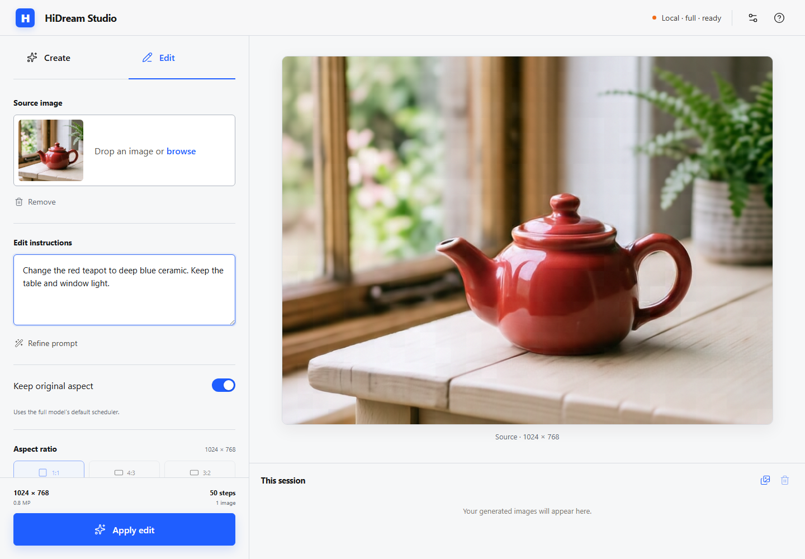

# HiDreamGenerator

A local image studio and MCP server built on [HiDream-O1-Image](https://github.com/HiDream-ai/HiDream-O1-Image). Describe an image, edit a reference, or generate from an agent while keeping inference on your own GPU.

This is a community application and integration layer. The underlying model and inference architecture are by HiDream.ai; their MIT attribution is preserved in [LICENSE](LICENSE).



## Features

- React/TypeScript studio: text-to-image, single-image editing, live previews, copy/download, and sequential batches of up to four.
- Optional local foreground masking for solid-background edits, preserving source colors and detail.
- Flask API: strict validation, a bounded GPU queue, reconnectable SSE progress, and explicit mock mode.
- MCP tools: generation, editing, composition from two to eight references, and optional prompt refinement.
- Installable HiDream skill: automatic selection for local image requests, with guidance for dimensions, model defaults, and long-running jobs.
- Output and render dimensions, seeds, mock status, prompts and effective settings embedded in API-generated PNGs. MCP also saves a JSON sidecar.

## Verified examples

Generated locally with the quantized full model described below, on an RTX 5060 Ti
16 GiB. These are real model outputs, not mock placeholders.

| Create: 1024×768 | Edit: 768×576 |
| --- | --- |
|  |  |

Creation used seed `314159`, 50 steps, guidance 5 and shift 3. The edit instruction
was “Change the red teapot to deep blue ceramic. Keep the table and window light.”
It used seed `271828`, 20 steps and the same guidance/shift; it rendered at
1728×1280 and exported at exactly 768×576. Both used UniPC. The observed runs took
141 and 351 seconds respectively; available VRAM, compilation and settings affect
timings substantially. These are functional smoke tests, not throughput benchmarks.

## Try it without a GPU

Requires Python 3.12+ and Node.js 22+. Clone the repository first:

```sh
git clone https://github.com/MaratG2/HiDreamGenerator.git
cd HiDreamGenerator
python -m venv .venv
# Windows PowerShell:
.venv/Scripts/Activate.ps1
# macOS/Linux: source .venv/bin/activate
python -m pip install -r requirements-test.txt
cd frontend
npm ci
npm run build
cd ..
python app.py --mock
```

Open [localhost:7860](http://127.0.0.1:7860). Mock mode produces labelled placeholders, not AI images. Python model dependencies are loaded only for real inference.

## Real inference

Requires a CUDA-capable NVIDIA GPU and compatible PyTorch. Download model weights separately. The locally tested setup uses Windows, an RTX 5060 Ti with 16 GiB VRAM, and a quantized full-model checkpoint.

```powershell
python -m venv .venv
.\.venv\Scripts\python.exe -m pip install -r requirements-windows-cuda.txt
.\.venv\Scripts\python.exe -c "from huggingface_hub import snapshot_download; snapshot_download('WaveCut/HiDream-O1-Image-SDNQ-4bit-dynamic-uint4-th1e-2', local_dir=r'HiDream-ai\HiDream-O1-Image-SDNQ-4bit')"
.\start_image_server.ps1
```

See [Windows setup](docs/WINDOWS.md) for optional acceleration and the separate prompt refiner. The specialized FlashAttention wheel only supports its documented GPU/dtype combination. Start with automatic attention selection or SDPA.

The launcher preserves `FA_VERSION` and SDNQ options from the environment/`.env`.
Use `-DisableQuantizationCompile` to run SDNQ without its optional compilation and
Triton matmul path when diagnosing startup or memory problems.

On another compatible CUDA system, install the correct CUDA-enabled PyTorch build, then `python -m pip install -r requirements.txt`. Quantized checkpoints additionally need their quantizer integration (SDNQ is in the Windows requirements). Build the frontend as above, then run:

```sh
python app.py --model_path /path/to/checkpoint --model_type full
```

Use `--model_type dev` only for a distilled dev checkpoint. The official [dev model](https://huggingface.co/HiDream-ai/HiDream-O1-Image-Dev-2604) uses 28 steps. Full defaults are 50 steps and shift 3, with guidance 1 for single-image edits and guidance 5 for text/composition; dev defaults are 28 steps, guidance 0, shift 1. Model type is not inferred from a renamed folder.

Copy `.env.example` to `.env` for local configuration. Keep `.env` private. Explicit launch arguments take priority; the Windows launcher has its own checkpoint default, overridden with `-ModelPath` and `-ModelType`.

The default is the balanced dynamic SDNQ checkpoint, which keeps all decoder attention-output and MLP-down projections in BF16. The former `last8` low-VRAM default protects only the final eight layers' projections. Both retain all decoder layers; `full` identifies the model family, not full precision. The unused text-output head and prompt-embedding table stay on CPU for untied checkpoints, saving about 2.3 GiB of GPU weight storage. Only the selected prompt rows transfer to CUDA. Tokenwise MLP chunking also bounds temporary inference memory without changing weights or resolution. Runtime settings and PNG/MCP metadata identify the actual checkpoint.

### Preserve the subject when changing a solid background

Install the optional [BiRefNet](https://huggingface.co/ZhengPeng7/BiRefNet) foreground
mask model after installing the real-inference requirements:

```powershell
.\.venv\Scripts\python.exe scripts/install_background_model.py
```

In **Edit**, leave **Preserve subject for solid backgrounds** checked and use a
simple instruction such as `Change the background to black` or
`Set the background to #18324A`. The server predicts a local subject mask and
composites the resized source onto that exact color. Confident subject pixels
remain identical to the resized original. Soft edges are blended; when the old
background is flat, its color spill is removed from those edges. Hair and other
ambiguous boundaries still depend on mask quality.

Only unambiguous, single-operation color requests use this path. Other edits
continue through HiDream. Uncheck the option, or pass
`preserve_background_subject=false` to the API/MCP edit tool, to force generative
editing. Without the optional model, edits continue through HiDream.

The result is labelled **Subject preserved**. PNG/MCP metadata reports
`engine=background_composite`, the mask checkpoint, and the actual color;
diffusion steps, guidance and seed have no effect on this deterministic edit.
It uses the selected output dimensions directly. Batches produce the same pixels.
No image is uploaded to another provider. The pinned model downloads once and
inference uses local files only.

This avoids the periodic texture and color drift observed when HiDream repaints
the entire source for a background-only change. Tests on the same portrait still
showed this texture with original unquantized BF16 weights and standard SDPA;
changing checkpoint precision alone did not fix it. General generative edits
can still show these artifacts. See [hardware notes](docs/WINDOWS.md).

## Settings contract

| Setting | Behavior |
| --- | --- |
| Output size | API dimensions are 512–4096 in multiples of 64. The returned PNG has the resolved output dimensions; unexpected dimensions are rejected. |
| Reference render size | Generative edits/composition use a roughly 4 MP minimum internal pixel budget (2048×2048 for square images), bounded to 4096 per edge, then resize to the exact output. The former 2 MP speed compromise is no longer the default. Larger requested outputs keep their size. Both sizes are disclosed as `width`/`height` and `render_width`/`render_height`; smaller exports do not necessarily make edits faster. Text-only generation uses the requested canvas directly. |
| Keep original aspect | One reference's proportions at the selected long edge, rounded to 64 pixels. It does not preserve the source's original pixel count. Extremely narrow sources are rejected. |
| Quality | Full: 12/20/32/50 steps, default 50. Dev: 12/20/28/50, default 28. Fewer steps trade detail for speed; more steps do not guarantee better output. |
| Edit guidance | Full edits default to guidance 1 to preserve source detail without amplifying compression artifacts. API/CLI/MCP callers can explicitly choose stronger guidance when needed. Progress previews include the selected guidance, matching the solver's prediction. |
| Scheduler | Full defaults to UniPC; dev text/composition uses Flash, dev edits use Flow Match. Explicit API/CLI choices are honored. |
| Custom steps/shift | Use generated timesteps. The trained 28-step dev schedule is preserved with steps=28, shift=1 and the default scheduler. |
| Flash noise controls | `noise_scale_end` and `noise_clip_std` require Flash; otherwise validation rejects them. |
| Seed | Integer 0–4294967295. Batches increment seeds and must stay in range. |
| References | PNG/JPEG/WebP, up to 24 MB and 24 megapixels each, within a 64 MB HTTP request. EXIF orientation is applied. |

The CLI shares generation defaults with the API:

```sh
python inference.py --model_path /path/to/checkpoint --model_type full \
  --prompt "A red ceramic teapot beside a window" --width 1024 --height 768 \
  --num_inference_steps 50 --output_image results/teapot.png
```

Refinement is optional. Configure `HIDREAM_REFINE_BASE_URL`, `HIDREAM_REFINE_MODEL` and, if needed, `HIDREAM_REFINE_API_KEY` on the server. HTTP clients cannot redirect the refiner to arbitrary URLs. Failures are reported visibly.

## Agents and API

See [MCP setup and tools](docs/MCP.md). The adapter uses the same image server and does not load another model. Registration is a separate explicit step.

For automatic skill selection in Codex, install the bundled skill with
`.\scripts\install_codex_skill.ps1` after MCP setup. Ask for HiDream or local
image generation, or invoke `$hidream` explicitly. The skill is portable and
versioned in [`skills/hidream`](skills/hidream/SKILL.md); installing it does not
start the GPU backend or connect ChatGPT in the cloud.

POST JSON to `/api/generate/start`, then subscribe to `/api/generate/stream/<job_id>`. Start and completion include effective dimensions/settings. SSE events have IDs; reconnect using `Last-Event-ID`. Completed jobs remain in memory up to 15 minutes, subject to a 16-job cache. Four running/queued jobs can be admitted; additional submissions receive HTTP 429. One GPU inference runs at a time.

Studio retains 40 images in browser memory. Reloading clears history; download images you want to keep. Disconnecting does not cancel GPU work. Brief interruptions reconnect automatically; full-page job recovery and cancellation are not implemented.

## Development

```sh
python -m pip install -r requirements-test.txt
python -m unittest discover -s tests -v
cd frontend
npm ci
npm run build
npm run dev
```

Vite runs at [localhost:5173](http://127.0.0.1:5173) and proxies `/api` to port 7860. Flask must also be running. `npm run lint` performs TypeScript checks, not ESLint. GitHub Actions checks API/MCP tests and frontend builds without downloading model weights. See [Contributing](CONTRIBUTING.md).

## Hosting and license

This is a local, single-user app. It binds to loopback and validates hosts/origins, request sizes and job limits. It has no authentication, durable job storage or per-user quotas.

Publishing the source does not require exposing the inference port. Shared hosting needs authenticated access, TLS, request/GPU quotas and a production server with one model-owning process. Do not expose Flask's development server directly on a public domain. See [SECURITY.md](SECURITY.md).

[MIT](LICENSE), preserving upstream attribution. Open source is not a public-domain dedication. Check the publisher's terms for each separately downloaded checkpoint.
